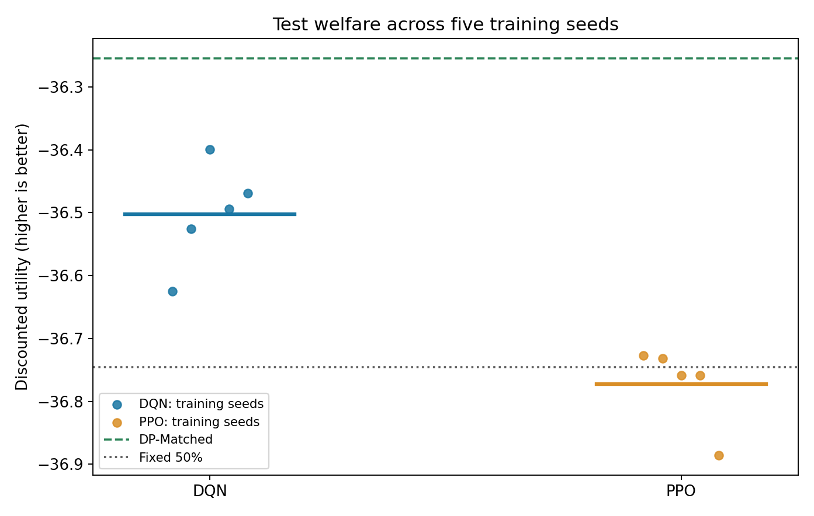

# Consumption–Saving with Reinforcement Learning

**서강대학교 강화학습개론 · 2026년 2학기 · 개인 프로젝트**

> Can model-free reinforcement learning learn near-optimal saving policies in a stochastic consumption–saving problem?

경제학의 확률적 소비·저축 모형을 MDP로 구성하고, **Dynamic Programming(DP)** 해를 benchmark로 하여 **DQN**과 **discrete PPO**의 정책 품질 및 후생을 비교했습니다. 본 실험은 합성 Markov 소득과 CRRA 효용을 사용하며 실측 가계 데이터를 활용한 프로젝트는 아닙니다.

## 결과 요약

| 모델 | 평균 할인효용 ↑ | 신뢰구간 95% | 평균 Policy MAE ↓ | DP 대비 CEV 손실 ↓ |
|---|---:|---|---:|---:|
| DP-Matched | -36.2548 | [-36.3400, -36.1697] | 0 | 0% |
| **DQN (5 seeds)** | **-36.5027** | **[-36.6054, -36.3999]** | **0.0525** | **0.684%** |
| Fixed 50% | -36.7452 | [-36.8396, -36.6508] | — | 1.353% |
| PPO (5 seeds) | -36.7721 | [-36.8529, -36.6913] | 0.1848 | 1.427% |

- DQN의 DP-Matched 대비 10%p 이내 저축률 선택 비율: **94.4%**.
- 5개 DQN training seed의 best checkpoint: **15k, 75k, 30k, 90k, 60k**.
- PPO는 같은 discrete action 설정에서도 fixed 50% 저축 정책보다 뚜렷하게 낫지 않았습니다.
- CEV는 소비 단위로 해석한 후생손실입니다. 위 DQN/PPO 구간은 **5개 training seed의 평균 test utility에 대한 t-based CI**, Fixed 및 DP 구간은 **Monte Carlo 경로 기반 CI**로 계산되었습니다. 서로 성격이 다른 신뢰구간이므로 직접 동일하게 해석하면 안 됩니다.



## 경제 모형 (MDP)

- **State**: 현재 자산 `a_t`와 현재 소득 `y_t`.
- **Action**: 저축률 `z_t ∈ {0, 0.05, ..., 0.95}` (20개 선택지).
- **Cash on hand**: `m_t = R·a_t + y_t`.
- **Consumption / next asset**: `c_t = (1-z_t)·m_t`, `a_(t+1) = z_t·m_t`.
- **Reward**: CRRA 소비효용 `u(c) = c^(1-σ)/(1-σ)`.
- **Objective**: `E[Σ β^t u(c_t)]` 최대화.
- **Income**: `y_H=1.0`, `y_L=0.472`; Markov transition matrix `[[0.9393,0.0607],[0.3920,0.6080]]`.
- **Calibration**: `R=1.00985`, `β=0.9703`, `σ=2`, asset grid `[0,4.5]` (500점).

`DP-Fine`은 자산-grid 상에서 촘촘한 next asset을 선택하고, `DP-Matched`는 RL과 같은 20개 저축 action만 선택하므로 RL과의 직접 비교에 사용합니다. 다만 DP에는 4.5 상한을 적용하는 반면 RL 환경은 자산을 상한으로 자르지 않는 모델링 차이가 있으므로, DP benchmark는 이 경계에서 엄밀한 전역 oracle은 아닙니다. 본 실험의 관측 상태와 평가 기준에서 이 한계를 명시합니다.

## 저장소 파일

```text
.
├── README.md
├── requirements.txt
├── main.ipynb                     # 실행 결과가 포함된 빠른 보고서용 노트북
├── src/models.py                  # 최종 DQN 구조와 checkpoint 불러오기
├── scripts/
│   ├── verify_models.py           # 모델 파일/가중치 검증
│   └── plot_results.py            # 최종 CSV로 그림 생성
├── experiments/
│   ├── full_training.ipynb        # 원래 5-seed DQN/PPO 전체 학습 코드
│   ├── risk_aversion.ipynb        # sigma comparative statics
│   └── ablations/                 # checkpoint, Double DQN, PPO 시도 기록
├── results/
│   ├── final_summary.csv
│   ├── final_seed_results.csv
│   └── figures/
└── models/                        # DQN .pt × 5, PPO .zip × 5
```

## 빠르게 결과 확인하기 (학습 재실행 불필요)

Colab에서 [main.ipynb](main.ipynb)을 열고 **런타임 > 모두 실행**하면 경제 환경 검증, DP, baselines, robustness 계산 및 최종 결과/그래프를 볼 수 있습니다. 5-seed DQN/PPO 학습은 오래 걸려 별도로 보존하며 `main.ipynb`의 최종 결과 표는 실제 수행한 실험 결과를 기록한 것입니다.

또는 터미널에서:

```bash
pip install -r requirements.txt
python scripts/verify_models.py
python scripts/plot_results.py
```

`verify_models.py`는 DQN 5개를 PyTorch로 실제 로드해 추론합니다. 필요한 패키지가 설치된 경우 PPO 5개도 Stable-Baselines3로 실제 로드합니다. `plot_results.py`는 완성된 CSV를 읽어 그래프를 재생성하며 RL 학습을 하지 않습니다.

## 전체 학습 다시 수행하기 (계산량 큼)

1. Colab에서 [experiments/full_training.ipynb](experiments/full_training.ipynb)을 엽니다.
2. 셀을 처음부터 실행하여 환경/DP/평가 함수만 로드합니다.
3. 마지막 셀에서 `RUN_FINAL_EXPERIMENT = False`를 `True`로 바꾸고 마지막 셀만 실행합니다.
4. DQN/PPO 각각 **5 seeds × 100k steps/timesteps** 학습하며 validation으로 checkpoint를 선택하고 결과 CSV/모델을 생성합니다.
5. 실험 완료 후 생성한 결과를 `results/`, `models/`에 저장합니다.

실험 환경과 라이브러리 버전에 따라 소요시간 및 재학습 결과의 세부 숫자는 달라질 수 있습니다. 5-seed 표는 원래 완료된 실행을 보관한 결과입니다. Colab 런타임은 영구 저장 공간이 아니므로 생성 후 Google Drive 등으로 복사하세요.

## 추가 실험과 해석

- **Checkpoint diagnostics**: 성능이 학습 동안 단조 증가하지 않고 best step이 seed별로 다름.
- **Double DQN**: 단일 seed 실험에서 baseline DQN 대비 뚜렷한 개선 미관측.
- **Continuous PPO**: Gaussian policy에서 boundary collapse가 발생. 정규화 후에도 제대로 해결되지 않음.
- **Discrete PPO**: DQN과 같은 action으로 공정 비교. 여러 seed에서 거의 고정된 저축률을 선택하며 state-dependent 학습이 약함.
- **Risk aversion**: σ=1.5, 2, 3으로 변화시킨 DP 비교정태에서 장기 저축·자산축적 증가.

이 결과는 *현재 모델, calibration, 학습 예산에 관한 관찰*이며 PPO 일반 성능에 대한 보편적 주장이나 순수 위험회피의 인과적 효과를 뜻하지 않습니다. σ는 CRRA 상대위험회피도뿐 아니라 기간 간 대체탄력성(IES=1/σ)과도 관련됩니다.

## 학습 완료 모델 다운로드

| 유형 | seed 0 | seed 1 | seed 2 | seed 3 | seed 4 |
|---|---|---|---|---|---|
| DQN (.pt) | [0](models/dqn_best_seed_0.pt) | [1](models/dqn_best_seed_1.pt) | [2](models/dqn_best_seed_2.pt) | [3](models/dqn_best_seed_3.pt) | [4](models/dqn_best_seed_4.pt) |
| PPO (.zip) | [0](models/ppo_best_seed_0.zip) | [1](models/ppo_best_seed_1.zip) | [2](models/ppo_best_seed_2.zip) | [3](models/ppo_best_seed_3.zip) | [4](models/ppo_best_seed_4.zip) |

DQN은 2→64→64→20 네트워크 구조를 사용하고, `torch.load(..., weights_only=True)`로 안전하게 state_dict만 로드합니다. PPO는 Stable-Baselines3의 `PPO.load(...)`를 사용합니다.

## 최종 PPT 보고서

- [최종 PPT 연구보고서](Consumption_Saving_RL_Final_Report.pptx)
- [최종 PDF 보고서](Consumption_Saving_RL_Final_Report.pdf)

본 프로젝트의 연구 목적, 경제모형과 MDP 설계, DP 및 RL 알고리즘, 5-seed 실험, 성능 분석, 위험회피도 비교정태와 연구의 한계를 PPT 보고서에 정리했습니다.

보고서 첫 슬라이드에는 작성자의 이름, 학번, GitHub 저장소 링크를 기재했습니다.

## 생성형 AI 활용 고지

이 프로젝트에서는 ChatGPT의 도움을 받아 연구 설계 토의, 경제모형/MDP 정리, Python 코딩 초안 및 디버깅, 실험 해석, README/제출물 구성 작업을 수행했습니다. 최종 실험은 Colab에서 실행되었고, 저장된 모델 및 결과 파일을 제출합니다. 작성자는 실행 결과, 의사결정 과정, 해석 및 코드 정확성을 검증할 책임이 있으며, AI 출력의 오류 가능성을 인정합니다.

## 한계

- 두 소득상태의 단순화된 Markov 소득 및 합성 시뮬레이션 환경.
- 5%p 단위의 이산 action, 자산 상한에 따른 수치해 근사, 유한 기간 Monte Carlo 평가.
- 최종 RL 성능은 5개 training seed와 고정된 예산/설정에 대한 결과.
- `main.ipynb`는 빠른 결과 확인 중심; **RL 전체 학습 코드는 `experiments/full_training.ipynb`에 별도로 보존**되어 있습니다.

